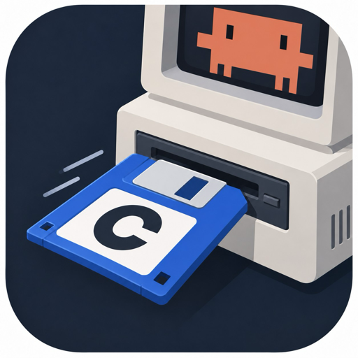

<p align="center">
  
</p>

<h1 align="center">Claude Mod Manager</h1>

Claude Mod Manager (cmod) installs and builds Claude Code mods. A mod is a Claude Code plugin built with the `@cmodjs/core` package. It can hear and change what happens in a session, and add panes, slash commands, tools, and permission rules, and it can run its own install step. cmod installs mods, runs their install and uninstall steps, and helps you build and publish your own.

## Install a mod

In Claude Code, add the mod's marketplace and install the mod:

```text
/plugin marketplace add <owner>/<repo>
/plugin install <mod>@<marketplace>
```

Claude Code installs the cmod plugin with the mod. To install the cmod plugin on its own, as an author building a mod does:

```text
/plugin install cmod --marketplace heyJordanParker/cmod
```

Once a mod is installed, cmod fetches the cmod program and opens the mod's install page, the `Install <mod>` tab of the Sidebar, and the mod runs its install step. The page asks for any setting the mod needs, and walks you through any step only you can do, such as signing in. A progress bar shows each step. A notice tells you when the mod is ready.

The Sidebar is cmod's pane beside the conversation. `meta+0` shows or hides it. Its tabs are the Dashboard, each page a mod opened, and Settings, and `0`, `1` to `8`, and `9` switch between them. `meta+m` and `/mods` open Settings.

Settings lists every mod with the one-line description from its `plugin.json`, whether Claude Code has it turned off, its own settings pages, its options, its hotkeys, and its changelog. When a mod installs, a toast says what it adds. Type a new combo for a hotkey, and every session uses it at once. `Turn off` and `Turn on` run `cmod disable` and `cmod enable`, and `Remove` asks once, then runs `cmod remove <mod>`. Under cmod, the Log lists the newest 100 errors of your mods from every session, each with `Copy` and `Report`, and Preferences holds the switch `Show errors from installed mods`.

An error of a mod you installed goes to the Log. A mod you run from its checkout, such as one you linked with `cmod link`, shows its errors as toasts, because you are its author, and a failed install or setup, a stopped program, or a failed button or hotkey shows a toast for every mod. When a mod needs something only you can give, such as a plugin it depends on, its message carries a button that takes you there.

Mods add widgets, such as the branch or a CI status. Settings, under cmod, Widgets, arranges every mod's widgets in rows: above the prompt, below it, under the spinner while Claude works, under each turn that ends, and on the Sidebar's Dashboard. Hide any widget there, Claude Code's own hint and mode labels below the prompt included. Claude Code always shows its permission mode. Every running session follows the layout at once.

When a `cmod` command, `/plugin`, `claude plugin`, or Claude Code's automatic update installs, updates, turns on or off, removes, links, or unlinks a plugin, every running session reloads its plugins by itself, once the changes have stopped for 2 seconds. A session in the middle of a turn reloads when the turn ends, and the prompt you are typing stays. When a plugin's version changed, a short toast in the corner says so, such as `notes updated to 1.3.0`. More than 3 at once show as one toast, such as `5 plugins updated`.

A mod keeps itself up to date. Its setup turns on Claude Code's automatic updates for the marketplace it came from, unless you already chose. Turn them off under `/plugin` Marketplaces.

When you remove a mod with `/plugin uninstall`, cmod runs the mod's uninstall step at the next session start or prompt. If Claude Code quits before the uninstall step finishes, the next session runs it again. If the uninstall step fails, a notice names the saved step to fix and the command that runs it again, `cmod teardown <mod>`. Once the uninstall step has run, every open session stops running the mod.

In a terminal, one command does the same, for a mod or any other Claude Code plugin:

```sh
cmod install <owner>/<repo>
```

A plugin that is not a mod installs through Claude Code alone. `cmod update`, `cmod enable`, `cmod disable`, and `cmod remove` work on any plugin the same way. The cmod plugin puts `cmod` in `~/.local/bin` the first time it runs. A mod that ships a program, such as `trace`, runs it by its name in Claude Code even when your system has a command of the same name, and a mod built only for some machines says so before it runs anything. `cmod list` shows every plugin Claude Code has, and whether cmod set up each mod.

## What the cmod plugin runs

The cmod plugin runs these programs, and sends no data anywhere:

- **`setup/bootstrap.sh`**, the first time it runs. It runs the `cmod` launcher from the `@cmodjs/cli` package Claude Code installs with the plugin. The launcher downloads the `cmod` program for your machine from the GitHub release of this version at github.com/heyJordanParker/cmod, checks it against the release's `SHA256SUMS`, keeps it in `~/.local/share/cmod/bin/cmod/<version>/`, and links `~/.local/share/cmod/programs/cmod` and `~/.local/bin/cmod` to it. It leaves a `~/.local/bin/cmod` it did not make in place. That download is its only network request.
- **`setup/path.sh`**, at each session start. It writes one line, once, to the file Claude Code reads into every Bash command's environment, `export PATH="~/.local/share/cmod/programs:$PATH"`, so Claude runs each program a mod installs by its name.
- **`cmod teardown <mod> --events`**, when you remove a mod. At each session start and prompt, the plugin reads `enabledPlugins` from your Claude Code user settings. For each mod that left the list, it runs `cmod teardown`, which runs the uninstall step the mod installed with.
- **`cmod option <mod> <key> <value>`**, when you save a setting in Settings, **`cmod hotkey <mod> <hotkey> <combo>`**, when you give a hotkey a new combo there, and **`cmod enable`**, **`cmod disable`**, and **`cmod remove`** with a mod's name, when you turn it on or off or remove it there.
- **`cmod hotkey cmod sidebar meta+0`** and **`cmod hotkey cmod settings meta+m`**, once, the first time the cmod plugin runs, to bind its own hotkeys.
- **`cmod history index`**, in the background at each session start while a mod other than cmod is set up. It reads your saved Claude Code conversations into an index on your machine, so a mod searches them at once. **`cmod history`** with a mod's question runs when that mod reads them, and **`cmod history follow`** runs while a mod listens to another running session.
- **`cmod watch`**, only while a mod you linked with `cmod link` is linked. One of them watches your checkouts, and tells every session once a change builds. It skips files git ignores. A change that still doesn't build after 10 seconds shows its error in one toast.
- **`cmod settings <mod> …`**, when a mod changes one of your Claude Code settings.
- **`cmod program <mod> -- <program> …`**, in each session of a mod that runs one copy of a program for the whole computer. One session's `cmod program` runs the program, and the others wait to take over when that session ends.
- **`cmod task start <prompt> --title <title>`**, when Claude's `start_background_agent` tool, or a mod, starts a task in a new background session. It runs `claude --bg`, and `claude agents --json --all` to find the new session.
- **`/reload-plugins`**, in each session an app shows, whenever a plugin is installed, updated, turned on or off, removed, linked, or unlinked, by a `cmod` command, `/plugin`, `claude plugin`, or Claude Code's automatic update. A session in the middle of a turn runs it when the turn ends. The cmod plugin of each session watches `~/.local/share/cmod/store-changed`, which each `cmod` command writes after it changes your plugins, and Claude Code's `installed_plugins.json`, and reads the `enabledPlugins` of your user settings each time Claude Code reports that file changed and at each prompt. The reload keeps the prompt cache.

A setting you change in Settings goes through `cmod option` to Claude Code's `/config`, the same place Claude Code keeps it when you change it there. When a mod changes Claude Code's settings, the cmod plugin keeps your own edits, and takes the mod's values out when you remove it.

It writes files in three places only. The first is the cmod store, `~/.local/share/cmod/`, which holds the `cmod` program with its link at `~/.local/share/cmod/programs/cmod`, the conversation index `history-11.sqlite`, the goals mods set in `data/cmod/goals/`, the record of the settings each mod changed in `settings/`, the address of each program a mod runs once for the whole computer in `instances/`, and the widget layout in `widgets.json` with the empty `store-changed` that tells every session it changed. The second is the link `~/.local/bin/cmod`. The third is Claude Code's own storage for the plugin, where it keeps the list of mods it has seen. `cmod setup` and `cmod hotkey` also write each mod's hotkeys into Claude Code's `~/.claude/keybindings.json`, and leave a combo you bound yourself in place.

Every mod built with cmod, the cmod plugin included, adds one hook on each Claude Code event a mod can use, and only a mod that decides permissions hooks Claude Code's permission check. So the cmod plugin hooks tool calls, prompts, and what Claude Code draws, and no permission check. On a tool call, the cmod plugin answers nothing of its own: it passes the event on unchanged. It never allows or denies a call, never rewrites a tool's input, and never changes a tool's output. It draws one line above the prompt while it downloads `cmod`, draws your mods' widgets where you placed them, and answers a call from one mod to another that names a mod you have not installed.

## Change a mod

Your changes to a mod live in its config folders, outside the mod's code. Each mod has two:

```text
~/.claude/cmods/<mod>/              yours, in every project
<project>/.claude/cmods/<mod>/      your team's, committed with the repository
```

A file in the project folder wins over the same file in yours. `CLAUDE_CONFIG_DIR` moves `~/.claude`, and removing the mod keeps both folders.

A mod's options, such as a token or a branch to watch, are yours to set in `/config`. To set them for your whole team, commit an `options.json` in the project folder that lists only the options to change:

```json
{ "branch": "release" }
```

The project's value wins over yours, and a value your organization set in managed settings wins over both. A secret never goes in the project file. The mod ignores an option it does not have and a value that does not fit, and logs one line naming the file, the option, and the fix. cmod reads the project's file when the mod starts, and again after a `/cd`.

To replace the text of a Skill a mod ships, put your own file at the same path in a config folder:

```text
~/.claude/cmods/<mod>/skills/<skill>/SKILL.md
```

Claude reads your text in place of the mod's from the next time the Skill loads, and updates keep it. cmod drops the file's frontmatter, so the mod's own name and description stay. Delete the file to get the mod's text back.

## Make a mod in 30 seconds

```sh
npm i -g @cmodjs/cli
cmod new my-mod
cd my-mod
cmod link
```

`npm i -g @cmodjs/cli` puts `cmod` on PATH, and `bun add -g @cmodjs/cli` does the same. `bunx @cmodjs/cli new my-mod` runs it once without installing. `cmod new` writes the mod and its `CHANGELOG.md`, and installs its packages. `cmod link` loads it in every Claude Code session, the running ones too. The mod lives in `src/`:

```text
src/
├── mod.tsx                     defineMod, its hotkeys, and setup: the page, the widget, the listeners
├── state.ts                    the starting state, grouped by how long it lasts
├── pages/
│   └── prompts.tsx             one Sidebar page per file
├── widgets/
│   └── prompts.tsx             one widget per file
└── components/
    └── prompt-count.tsx        what the page and the widget draw with
```

`src/mod.tsx` adds each part with one line, and the hotkey shows or hides the page:

```tsx
import { defineMod, sessions } from '../node_modules/@cmodjs/core/mod.js'
import { promptsPage } from './pages/prompts.js'
import { initialState } from './state.js'
import { promptsWidget } from './widgets/prompts.js'

export const myMod = defineMod({
  name: 'my-mod',
  state: initialState,
  hotkeys: {
    toggle: { title: 'Show or hide the prompt count', default: 'alt+shift+p' },
  },

  setup(mod) {
    const page = mod.sidebar.add(promptsPage)
    mod.widgets.add(promptsWidget)
    mod.hotkeys.toggle.onPress(() => page.toggle())

    sessions.current.onPrompt(() => {
      mod.state.session.prompts += 1
    })
  },
})
```

`src/state.ts` holds the starting state:

```ts
export type MyModState = { session: { prompts: number } }

export const initialState: MyModState = { session: { prompts: 0 } }
```

`src/pages/prompts.tsx` is the mod's Sidebar page:

```tsx
export const promptsPage: PageInit<MyModState> = {
  id: 'prompts',
  title: 'Prompts',
  render: (mod) => <PromptCount count={mod.state.session.prompts} />,
}
```

`src/widgets/prompts.tsx` is the mod's widget. It first draws below the prompt, and the person can move it to the Dashboard:

```tsx
export const promptsWidget: WidgetInit<MyModState> = {
  id: 'prompts',
  title: 'Prompt count',
  areas: [BelowPrompt, Dashboard],
  render: (mod) => <PromptCount count={mod.state.session.prompts} />,
}
```

`src/components/prompt-count.tsx` is what the page and the widget draw:

```tsx
export function PromptCount({ count }: { readonly count: number }): RenderElement {
  return <Text>{`Prompts this session: ${count}`}</Text>
}
```

Start `claude`, and the mod counts every prompt. `alt+shift+p` shows the count in the Sidebar. `cmod check` writes the hotkeys and options `defineMod` declares into the manifests, then checks the layout, the imports, and the lint, validates the mod with Claude Code, compiles it against Claude Code's API, and runs its tests. A fresh clone has no `.claude-plugin/types/`, Claude Code's description of its API, so `cmod check` has Claude Code write it before compiling. `cmod publish` releases the mod on GitHub, and prints the link that lists it in Anthropic's plugin directory.

## Docs

The mod author docs live in [core/docs/](core/docs/index.md) and ship inside `@cmodjs/core`. So every mod's `node_modules/@cmodjs/core/docs/` holds the docs of the version it installed. The `.claude/CLAUDE.md` that `cmod new` writes points coding agents there. A project plugin, made with `cmod new --project`, gets no `.claude/CLAUDE.md`.

- [index.md](core/docs/index.md): what a mod is, and which file answers which question
- [mod.md](core/docs/mod.md): `defineMod`, `setup`, what `mod` can call, and the imports, `commands` and `config` included
- [state.md](core/docs/state.md): state groups and Skill overrides
- [options.md](core/docs/options.md): options a person sets, typed in code, stored by Claude Code
- [session.md](core/docs/session.md): `sessions`, the conversation as contexts, turns, messages, a goal, and tasks, and every `on` and `before` method
- [ui.md](core/docs/ui.md): the Sidebar and its pages, Settings pages, panes, widgets, styles, markdown blocks, elements, the button rule, toasts, questions, and the conversation's rows
- [jobs.md](core/docs/jobs.md): slash commands, tools, permission rules, checks, prompts, schedules, and programs
- [dependencies.md](core/docs/dependencies.md): calling another mod
- [install-steps.md](core/docs/install-steps.md): install and uninstall steps, and shipping a program
- [testing.md](core/docs/testing.md): `testMod`
- [commands.md](core/docs/commands.md): every `cmod` command

## What is in this repository

- The root is the cmod plugin. It fetches the cmod program, runs the uninstall step of each mod Claude Code removes, and carries calls from one mod to another.
- [core/](core/) is `@cmodjs/core` on npm, the library every mod imports, with its docs in [core/docs/](core/docs/index.md).
- [cli/](cli/) is `@cmodjs/cli` on npm, the `cmod` command, which runs the newest cmod program. It also holds the source of the cmod program, which each GitHub release carries for macOS and Linux.
- [CONTRIBUTING.md](CONTRIBUTING.md) runs cmod from a checkout, runs the gate, and releases.

## License

MIT. See [LICENSE](LICENSE).
